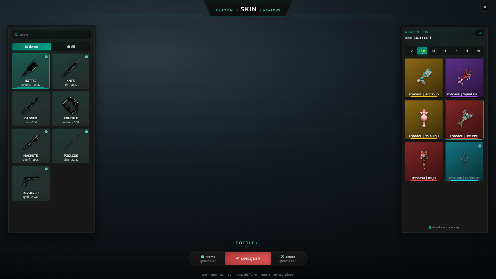

# Hyper Weaponskin

เปลี่ยนหน้าตาอาวุธประชิดและลูกโม่ในเซิร์ฟเวอร์ให้เป็นสกินพิเศษ — ผู้เล่นเปิดเมนูเลือกสกินที่ตัวเองครอบครอง กดใส่แล้วโมเดลสกินจะไปเสียบแทนอาวุธจริงในมือ พร้อมออร่าวนตอนถืออาวุธ และเฟรมเต็มจอ + เสียง ตอนตีหรือฆ่าคู่ต่อสู้

## ข้อมูลทั่วไป

| หัวข้อ | ค่า |
| --- | --- |
| เวอร์ชัน | 4.1.0 |
| เฟรมเวิร์ก | ESX (`config/framework/esx/`) |
| ฐานข้อมูล | oxmysql — ตาราง `hyper_weaponskin` (สร้างเองตอนบูต) |
| ต้องมี | `oxmysql`, `Hyper_Check` |
| ทำงานร่วมกับ | `Hyper.Allweapons`, `Hyper.Allweaponskins`, `Hyper_Inventory`, `Hyper_Notifyall`, `Hyper_Compass`, `Hyper_Discordlogs` |
| หน้า NUI | `html/index.html` |
| คำสั่งเปิดเมนู | `/weaponskin` |
| หมวดอาวุธ | 7 หมวด |
| ตัวแปรอาวุธ | 49 ตัว (7 หมวด × ระดับ +0 ถึง +6) |
| สกินในแคตตาล็อก | 45 รายการ · 8 ธีม |
| ธีมสี UI | 7 ธีม |

## เริ่มจากตรงไหน

| อยากรู้ | ไปที่ |
| --- | --- |
| ทำอะไรได้บ้าง | [ฟีเจอร์](features.md) |
| ปรับค่าตรงไหน | [การตั้งค่า](config.md) |
| หน้าจอแต่ละโหมดหน้าตาเป็นยังไง | [หน้าจอ UI](ui-screens.md) |
| เปลี่ยนสีระบบ | [ธีมสี](themes.md) |
| ทำงานยังไง ปลอดภัยแค่ไหน | [เทคโนโลยี](technology.md) |
| เรียกจาก resource อื่น | [Export](export/README.md) |


ตัวเลขและรายการสกินในภาพหน้าจอทุกใบเป็นข้อมูลจำลองที่ใส่เข้าไปเพื่อถ่ายภาพ ไม่ใช่ข้อมูลผู้เล่นจริง — ตัวละครที่ยืนอยู่ตรงกลางจอเป็นภาพที่ตัวเกมวาดอยู่ข้างหลังหน้าเว็บ จึงไม่ติดมาในภาพ

