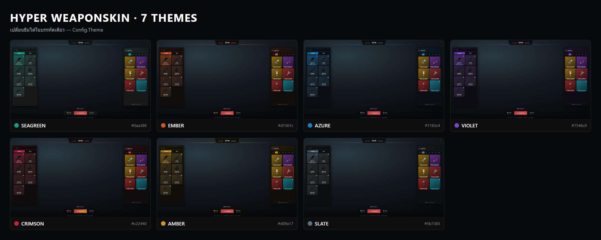
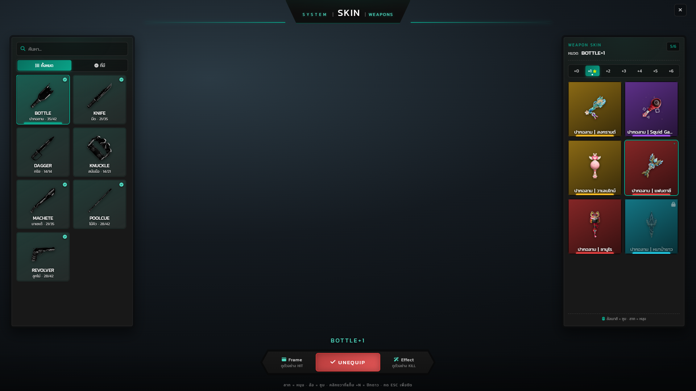
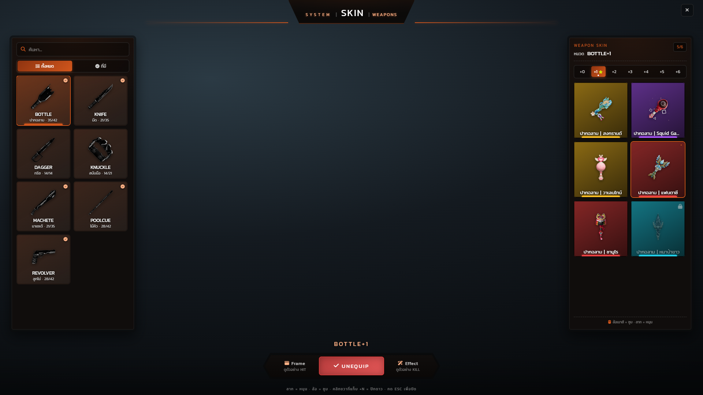
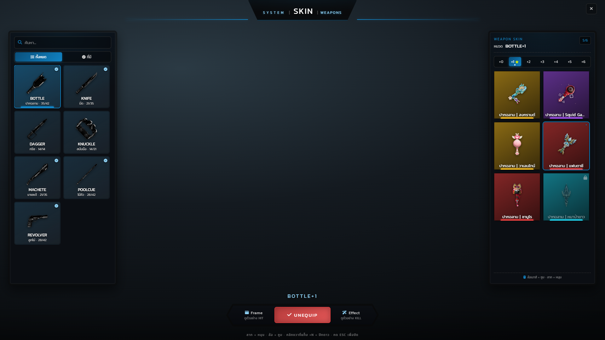
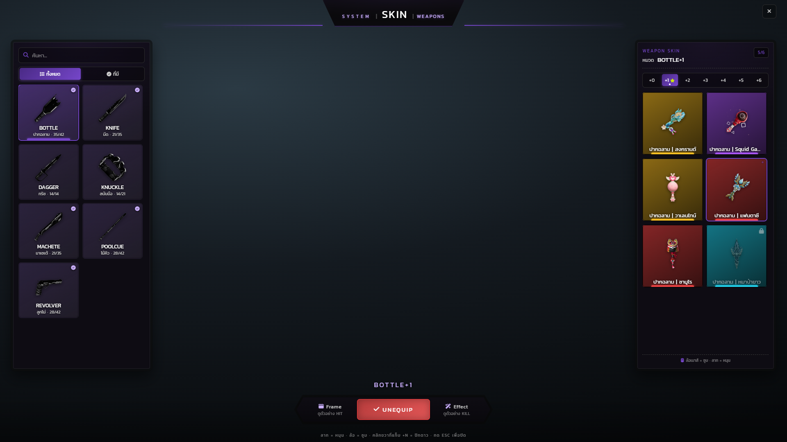
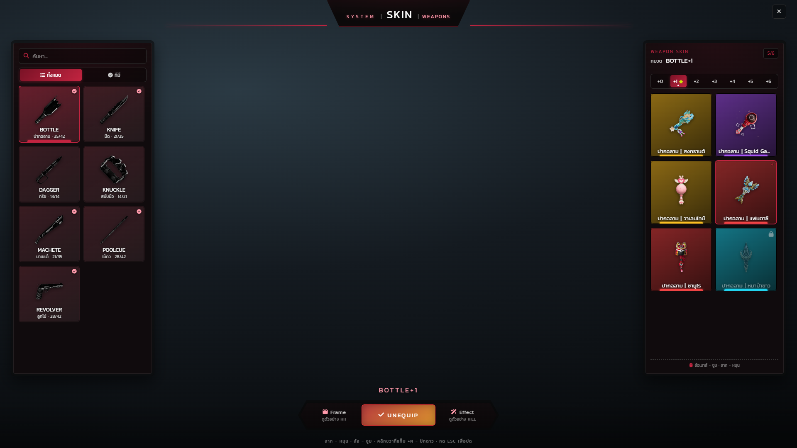
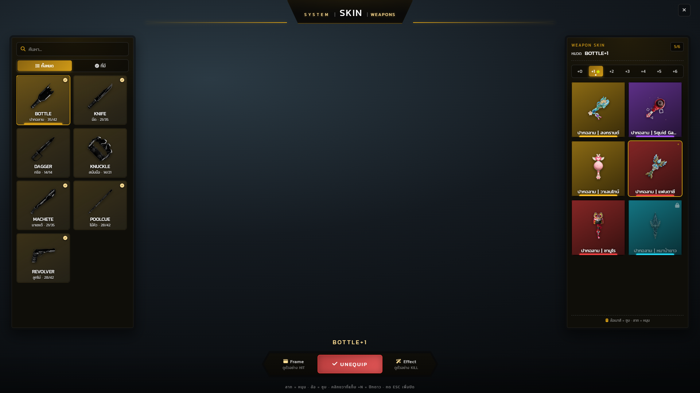
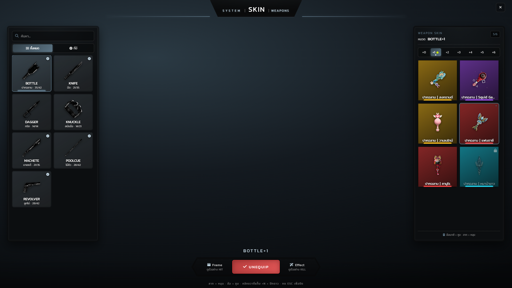

# ธีมสี

เมนูมีธีมสีให้เลือก 7 ชุด เปลี่ยนได้ในบรรทัดเดียว

```lua
-- config/config.client.lua
Config.Theme = "seagreen"
```



## ตารางสี

สีที่ลิสต์คือ `--c-accent` ซึ่งเป็นสีไฮไลท์หลัก แต่ละธีมประกาศพาเลตต์ครบชุด 7 ค่า (สีหลัก, ไฮไลท์, สว่าง, อ่อน, สว่างสุด, พื้นแผง, แดงเตือน) ไว้ในบล็อก `[data-theme]` ของ `html/css/style.css`

| ธีม | สีไฮไลท์ | พื้นแผง | อารมณ์ |
| --- | --- | --- | --- |
| `seagreen` | `#0aa388` | `#181818` | ค่าเริ่มต้น เขียวทะเล ชุดเดียวกับหน้าอื่นของเซิร์ฟ |
| `ember` | `#d1561c` | `#100d0c` | ส้มถ่านไฟ |
| `azure` | `#1183c4` | `#0b0e13` | ฟ้าน้ำทะเล |
| `violet` | `#7546c9` | `#0e0c13` | ม่วง |
| `crimson` | `#c22440` | `#100b0d` | แดงเลือดหมู (เปลี่ยนสีเตือนเป็นเหลือง `#d9922e` ด้วย) |
| `amber` | `#d09a17` | `#0f0e09` | เหลืองอำพัน |
| `slate` | `#5b7383` | `#0c0e10` | เทาอมฟ้า เรียบที่สุด |

## ธีมเปลี่ยนอะไร / ไม่เปลี่ยนอะไร

| เปลี่ยน | ไม่เปลี่ยน |
| --- | --- |
| ป้ายหัวหน้าต่างและเส้น accent สองข้าง | สีการ์ดสกิน — มาจากระดับความหายากของสกิน ไม่ใช่ธีม |
| ขอบและพื้นของการ์ดหมวดที่เลือกอยู่ | แถบสีที่ก้นการ์ดสกิน |
| ปุ่มตัวกรองที่ active | ภาพเฟรม HIT / KILL |
| แท็บระดับที่เลือก ดาว และจุดสถานะ | รูปไอเทมของสกิน |
| ปุ่ม EQUIP (UNEQUIP ใช้สีแดงเตือนของธีม) | ตัวอักษรขาวและข้อความ hint ล่างจอ |
| สีพื้นแผงทั้งซ้ายและขวา | |

ชื่อธีมที่ไม่มีในรายการจะตกกลับไปใช้ `seagreen` อัตโนมัติ ไม่ทำให้ UI ไม่มีสไตล์

## ทีละธีม

### seagreen (ค่าเริ่มต้น)



### ember



### azure



### violet



### crimson



### amber



### slate


