# หน้าจอ UI

ภาพทุกใบถ่ายจากหน้า NUI จริงของ resource โดยส่งข้อมูลเข้าไปแบบเดียวกับที่ฝั่ง Lua ส่ง — ข้อมูลที่เห็นเป็นข้อมูลจำลอง

ช่องว่างกลางจอไม่ใช่ความผิดพลาด: หน้าเว็บโปร่งใสตรงนั้นเพื่อให้เห็นตัวละครที่ตัวเกมวาดอยู่ข้างหลัง ซึ่งไม่ติดมากับภาพที่ถ่ายจากเบราว์เซอร์

## 1. เมนูหลัก

หน้าตาตอนเปิดเมนู แบ่งสามส่วน: ซ้ายคือกริดหมวดอาวุธพร้อมช่องค้นหาและตัวกรอง กลางคือเวทีตัวละครกับปุ่ม EQUIP ขนาบด้วยปุ่มดูตัวอย่าง ขวาคือแท็บระดับ +0 ถึง +6 และกริดสกินของระดับที่เลือก เมนูเปิดมาที่ระดับที่ผู้เล่นใส่สกินไว้อยู่แล้ว ปุ่มกลางจึงขึ้นว่า UNEQUIP

## 2. เลือกหมวดอาวุธ

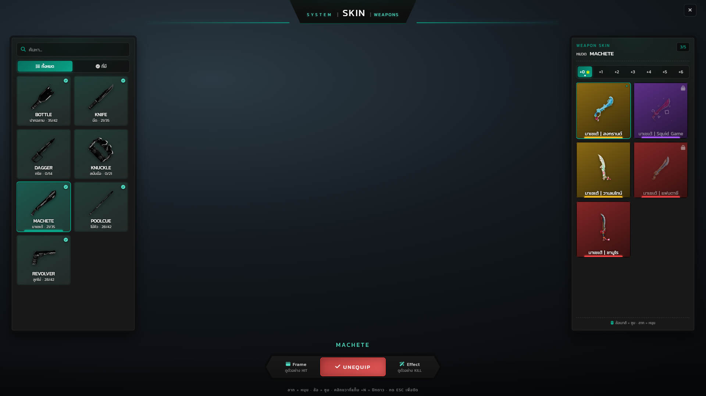

คลิกการ์ดหมวดทางซ้ายแล้วกริดขวาสลับไปเป็นสกินของหมวดนั้นทันที ติ๊กถูกมุมขวาบนของการ์ดแปลว่าผู้เล่นมีตัวอาวุธหมวดนั้นติดตัวจริง ตัวเลขใต้ชื่อคือสกินที่ครอบครองเทียบกับทั้งหมดของหมวด

## 3. แท็บระดับอาวุธ

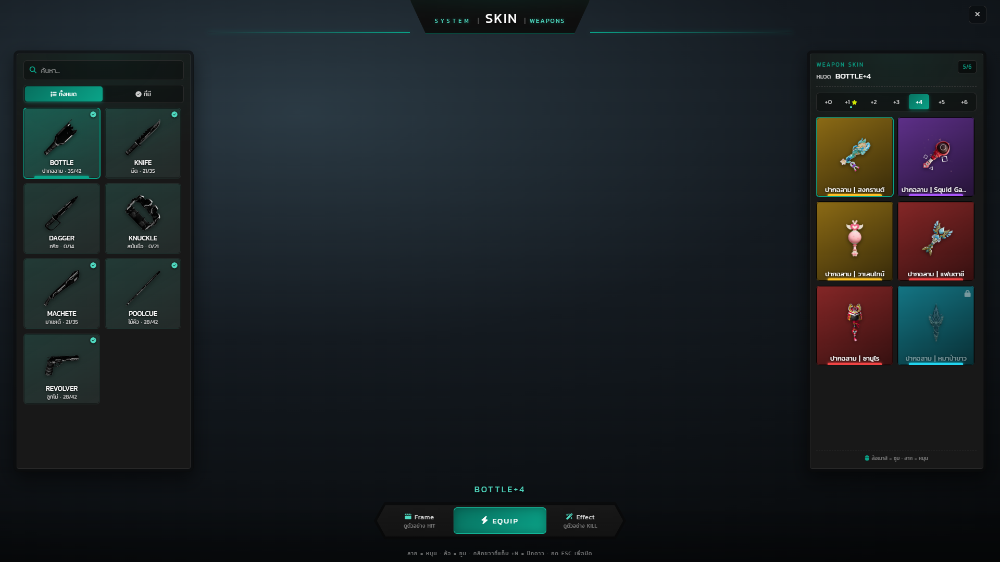

แต่ละระดับเป็นอาวุธคนละตัว จึงใส่สกินแยกกันได้ ดาวบนแท็บ +1 คือระดับที่ปักดาวไว้ จุดเล็กใต้แท็บคือระดับที่มีสกินใส่อยู่ ระดับ +4 ในภาพยังไม่ได้ใส่สกิน ปุ่มกลางจึงเป็น EQUIP

## 4. เลือกสกิน

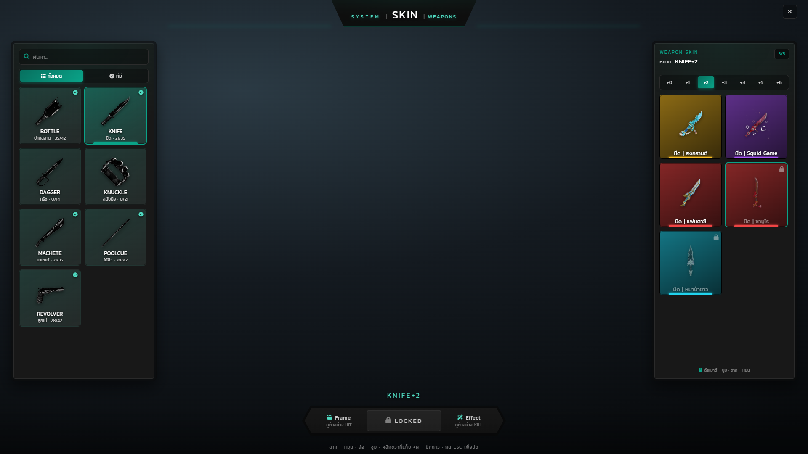

การ์ดที่เลือกมีขอบเรืองแสง พื้นการ์ดไล่สีตามระดับความหายากของสกิน และมีแถบสีเดียวกันที่ก้นการ์ด สกินที่ยังไม่มีไอเทมปลดล็อกจะหรี่ลงพร้อมแม่กุญแจมุมขวาบน

## 5. สกินที่ยังล็อก

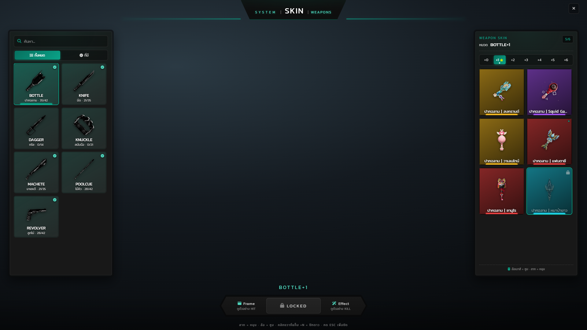

เลือกสกินที่ยังไม่มีไอเทม ปุ่มกลางเปลี่ยนเป็น LOCKED พร้อมแม่กุญแจและกดไม่ได้ ฝั่ง server ตรวจซ้ำอีกชั้นก่อนบันทึก จึงยิง event ตรงมาสวมสกินที่ไม่ได้ครอบครองไม่ได้

## 6. หมวดที่ยังไม่มีสกินเลย

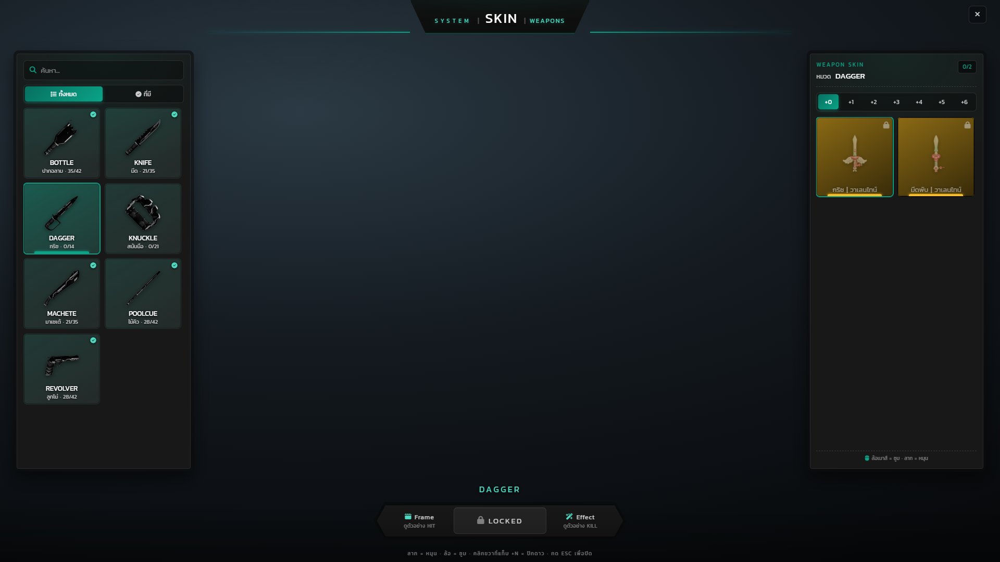

หมวดกริชในภาพยังไม่มีสกินสักชิ้น ตัวนับหัวแผงขวาขึ้น 0/2 และการ์ดทุกใบล็อก ผู้เล่นยังเปิดดูได้ว่ามีอะไรให้ตามเก็บบ้าง

## 7. ตัวกรอง "ที่มี"

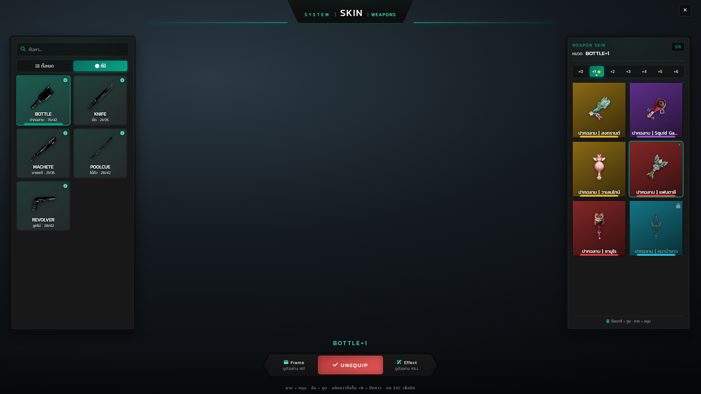

สลับมาที่ "ที่มี" แล้วรายการหมวดเหลือเฉพาะหมวดที่ครอบครองสกินอย่างน้อยหนึ่งชิ้น — กริชกับสนับมือหายไปจากลิสต์

## 8. ค้นหา

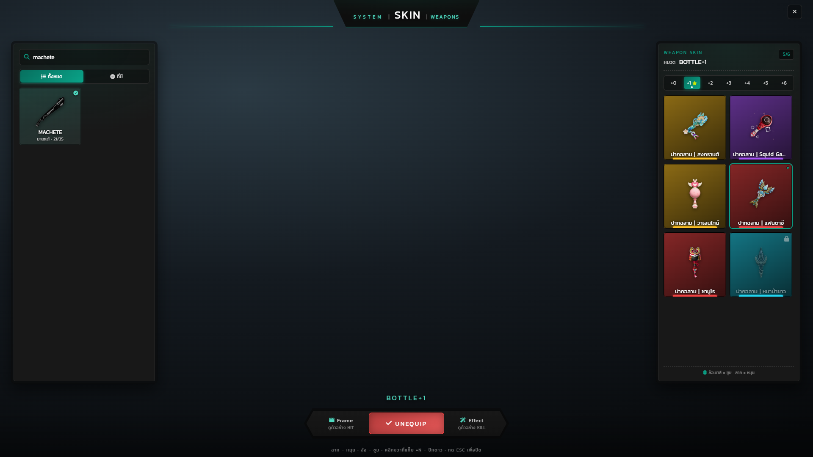

ช่องค้นหาด้านบนกรองรายการหมวดจากทั้งชื่ออังกฤษและชื่อไทย พิมพ์แล้วกรองทันทีโดยไม่ต้องกดปุ่ม

## 9. หลังกดใส่สกิน

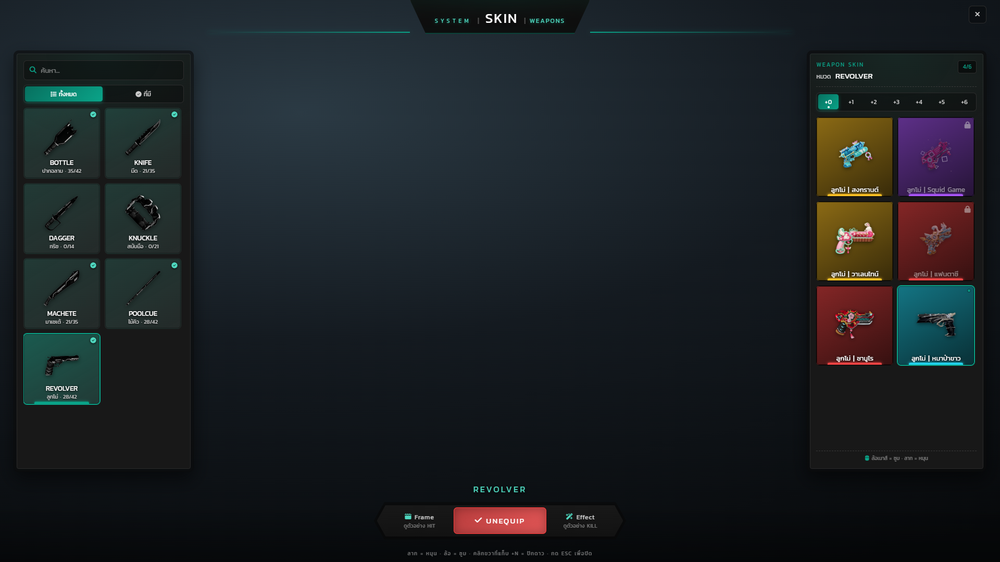

กด EQUIP แล้ว server ตรวจสิทธิ์และบันทึกลงฐานข้อมูล จากนั้นการ์ดสกินนั้นขึ้นจุดแสดงสถานะ ปุ่มกลางกลายเป็น UNEQUIP และไอคอนอาวุธในกระเป๋าเปลี่ยนเป็นรูปสกิน

## 10. ปักดาวระดับ

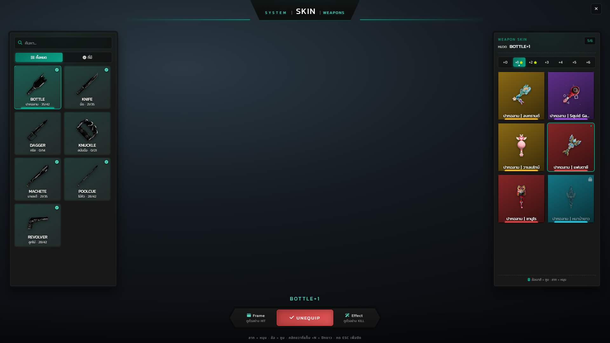

คลิกขวาที่แท็บ +N เพื่อปักดาวระดับที่ใช้บ่อย ดาวเก็บลงฐานข้อมูลคู่กับสกินที่ใส่ จึงอยู่ครบหลังเข้าเกมใหม่

## 11. เฟรมตอนตี

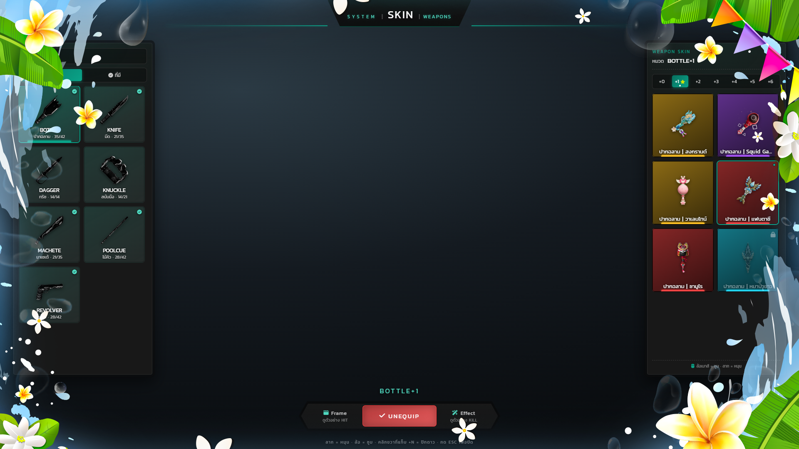

ตีคู่ต่อสู้โดนแล้วฝั่งเหยื่อเห็นเฟรมเต็มจอประจำธีมสกินพร้อมเสียงประกอบ ภาพนี้คือเฟรมธีมสงกรานต์ ความยาวและโอกาสออกตั้งได้ต่อสกิน

## 12. เฟรมตอนฆ่า

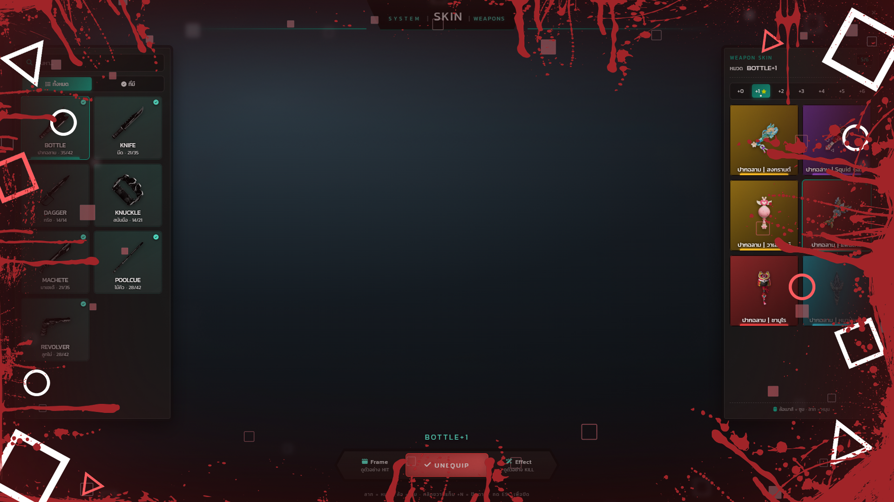

ฆ่าสำเร็จจะใช้เฟรมชุด KILL ซึ่งยาวกว่าและเสียงเบากว่า ภาพนี้คือธีม Squid Game พร้อมกันนั้นพาร์ทิเคิลจะยิงบนตัวเหยื่อแบบที่ทุกคนรอบตัวมองเห็น
